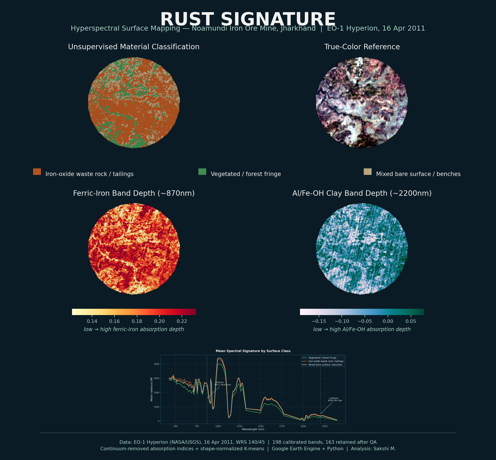

# Rust Signature: iron-oxide mapping at Noamundi with EO-1 Hyperion

A short case study. I take one EO-1 Hyperion scene (16 April 2011) over the Noamundi iron-ore mine in Jharkhand, India, and ask a simple question: does the ferric-iron absorption near 900 nm show up where the mine is?

## What I did

1. **Data.** Hyperion scene of 16 April 2011 from Google Earth Engine (`EO1/HYPERION`), clipped to a 3 km radius around the workings (`scripts/00_gee_export.js`). The scene edge cuts off the eastern part of the circle, so 25.65 km² is analysed.
2. **Radiance.** Earth Engine stores Hyperion as scaled integers, so I divide by 40 (VNIR, B008–B057) and by 80 (SWIR, B077–B224) to get radiance.
3. **Band clean-up.** I drop the water-vapour and CO₂ bands (1115–1145, 1340–1470, 1790–1970, 1995–2020 nm), the SWIR bands that repeat the end of the VNIR range, and bands that are empty or drop out. 157 of 198 bands remain. Vertical detector stripes are evened out by matching each column's mean and spread to the band's (moment matching).
4. **Relative reflectance.** I use IARR (Kruse, 1988): each pixel's radiance divided by the scene-mean radiance in that band. It is simple and needs no atmospheric model, but the result is relative to this scene.
5. **Indices.**
   - NDVI from red (640–680 nm) and NIR (820–880 nm) radiance.
   - Ferric-iron band depth: 1 − centre / continuum. The centre is 860–910 nm and the straight-line continuum runs between 740–780 nm and 990–1030 nm.
6. **Classes.**
   - Vegetation: NDVI above an Otsu threshold.
   - Bare ground with iron-oxide absorption: ferric band depth > 0, i.e. a dip deeper than the scene average.
   - Bare ground without clear absorption: the rest.
7. **Check against the mine.** I compare the classes with the three working areas listed by corner coordinates in the Indian Bureau of Mines inspection report for the mine: Hill 3&4, Hill 5&6 and the Western Pit.

I run the whole analysis with one command, `python run_all.py`, on the exported tif in this folder.

## Results

| | |
|---|---|
| Area analysed | 25.65 km² |
| Vegetation | 18.32 km² |
| Bare ground with iron-oxide absorption | 6.42 km² |
| Bare ground without clear iron-oxide absorption | 0.91 km² |
| Pixels with iron-oxide absorption, inside the mine working areas | 68% |
| Pixels with iron-oxide absorption, rest of the area | 23% |
| Median ferric band depth: vegetation / bare in working areas / bare elsewhere | −0.019 / 0.048 / 0.049 |

- The bare ground shows a clear absorption trough centred near 880–900 nm, the shape expected for ferric iron (hematite, goethite). Vegetation shows none.
- The mine working areas are about three times as likely as the rest of the area to fall in the iron-oxide class.
- Inside bare ground, the working areas look the same as the other bare ground (median depth 0.048 vs 0.049). The pits, benches and waste dumps around them all carry the iron signal, so at 30 m the three listed pits cannot be told apart from the rest of the mining complex.

## Limits

- One date (2011), 30 m pixels, no field or lab spectra. The class is "bare ground with an iron-oxide absorption", not an ore-grade map.
- IARR is relative to the scene mean, and this scene is mostly forest. So "deeper than average" partly means "less vegetated". Ferric depth and NDVI correlate at r = −0.80.
- The working areas are rectangles built from corner coordinates, so their edges are approximate.
- Hyperion's SWIR signal is noisy, so I do not use the 2200 nm clay feature for any class.

## Policy context: a monitoring condition

- **The clearance asks for this measurement.** The mine's environmental clearance of 10 June 2013 (J-11015/104/2011-IA.II(M), specific condition 33) requires "digital processing of the entire lease area using remote sensing technique" once in three years. The clearance of 6 September 2021 asks for a land use and land cover map of the lease once in five years. In the operator's compliance report for October 2025 to March 2026, the reply is that a private agency prepares the map; no dates, resolution or results are given.
- **A record the regulated firm produces.** The lease covers 1,160.06 ha, of which 762.42 ha is forest land (same report). The map that shows whether this land is worked and reclaimed as approved is commissioned by the operator and summarised in its own report. That is self-reported compliance, and the regulator has to verify what the firm reports.
- **What a public check adds.** Free archive imagery, code anyone can rerun, and a benchmark taken from the regulator's own inspection report. This study shows that such a check can confirm where the ground is open. At 30 m it cannot say which pit is active, or whether a dump has been reclaimed to the standard the closure plan sets.
- **A baseline before the condition.** The scene is from April 2011, two years before the 2013 condition. The same measure on a recent image would turn a footprint into a change, which is what a monitoring condition is meant to track.

## The footprint at the state's own forest price

India charges a one-off Net Present Value (NPV) for each hectare of forest land diverted to non-forest use; it is paid into the compensatory afforestation fund. Applied to the measured bare ground, the schedule gives an order of magnitude, not a bill.

| NPV rate used | Rs lakh per ha | 7.33 km² (733 ha), Rs crore |
|---|---|---|
| Lowest: eco-class IV, open forest | 6.70 | 49.1 |
| Highest: eco-class I, very dense forest | 15.96 | 117.0 |

Rates after the revision reported in January 2022, which raised the earlier schedule by a factor of 1.53.

- **What the number is.** A national schedule set by forest class and canopy density. It is a transferred value: a hectare of sal forest in West Singhbhum is charged the same as any other hectare of that class and density, whatever the people around it use it for.
- **What it is not.** A figure for this lease. The 3 km window is not the lease boundary, which is not public as a map, and part of the bare ground was diverted long before 2011 or was never forest.
- **What would value it properly.** A site-specific value for the forest the mine replaced: a stated-preference survey, such as a choice experiment with the households that use the forest, for the services the national schedule averages away. The satellite measure supplies the quantity; the price has to come from valuation, and that is where most of the uncertainty in the range sits.

## Reading the indicator as a variable

If the iron-oxide class were used as a regressor, for example mining disturbance in a study of forest livelihoods, the structure of its error would matter more than its accuracy.

- **The error is not classical.** A misclassified 0/1 indicator cannot have an error independent of the truth: a disturbed pixel can only be missed and an undisturbed one only falsely flagged (Aigner, 1973). Here the error also moves with vegetation cover: band depth and NDVI correlate at r = −0.80.
- **The 23% is not a false-positive rate.** Much of the ground outside the three boxes is real mine ground that the inspection report does not list, so the benchmark measures agreement, not error.
- **So the bias has no safe direction.** Classical error pulls an estimate toward zero. If the error is tied to vegetation, and vegetation also affects the outcome being studied, the bias can go either way.
- **What would fix it.** A validation sample with known status, such as surveyed workings, to estimate the misclassification rates and correct for them. Jain (2020) makes the same point for satellite data in causal studies.

## Declarations

The short statement is in [`RS_Declarations.pdf`](RS_Declarations.pdf) (source: [`RS_Declarations.md`](RS_Declarations.md)):

- **Type of work:** a short methods case study, not a peer-reviewed paper or preprint.
- **Author, funding, interests:** single author; no funding; no competing interests and no link with the mine's operator.
- **Data:** public USGS EO-1 Hyperion imagery (via Google Earth Engine), the public Indian Bureau of Mines inspection report and the operator's published compliance report; no ethical approval needed.
- **AI assistance:** Claude (Anthropic) helped check the reported numbers against `outputs/summary.json`, trace script errors, and flag unclear wording and punctuation in my own text. For the November 2026 sections on policy context, forest price and the indicator as a variable, it also helped find the public sources and drafted text that I checked and edited. The analysis choices and interpretation are mine.

## Files

- `scripts/00_gee_export.js`: Earth Engine export
- `scripts/01_prepare.py`: radiance, band clean-up, destriping, IARR, band QA plot
- `scripts/02_indices_and_classes.py`: NDVI, ferric depth, classes, working-area check, `outputs/summary.json`
- `scripts/03_figures_and_map.py`: maps, poster, interactive map (`outputs/noamundi_classification_map.html`) and plots

## References

- Aigner, D. J. (1973). Regression with a binary independent variable subject to errors of observation. *Journal of Econometrics*, 1(1), 49–59.
- Clark, R. N., & Roush, T. L. (1984). Reflectance spectroscopy: Quantitative analysis techniques for remote sensing applications. *Journal of Geophysical Research*, 89(B7), 6329–6340.
- Gadallah, F. L., Csillag, F., & Smith, E. J. M. (2000). Destriping multisensor imagery with moment matching. *International Journal of Remote Sensing*, 21(12), 2505–2511.
- Hunt, G. R. (1977). Spectral signatures of particulate minerals in the visible and near infrared. *Geophysics*, 42(3), 501–513.
- Jain, M. (2020). The benefits and pitfalls of using satellite data for causal inference. *Review of Environmental Economics and Policy*, 14(1), 157–169.
- Kruse, F. A. (1988). Use of airborne imaging spectrometer data to map minerals associated with hydrothermally altered rocks in the northern Grapevine Mountains, Nevada and California. *Remote Sensing of Environment*, 24(1), 31–51.
- Magendran, T., & Sanjeevi, S. (2014). Hyperion image analysis and linear spectral unmixing to evaluate the grades of iron ores in parts of Noamundi, Eastern India. *International Journal of Applied Earth Observation and Geoinformation*, 26, 413–426.
- Otsu, N. (1979). A threshold selection method from gray-level histograms. *IEEE Transactions on Systems, Man, and Cybernetics*, 9(1), 62–66.
- MoEF&CC effects upward revision in NPV, with certain exemptions. (2022, January 21). *The Hitavada*.
- Pearlman, J. S., Barry, P. S., Segal, C. C., Shepanski, J., Beiso, D., & Carman, S. L. (2003). Hyperion, a space-based imaging spectrometer. *IEEE Transactions on Geoscience and Remote Sensing*, 41(6), 1160–1173.
- Tata Steel. (2026). *Half-yearly environmental clearance compliance report, Noamundi Iron Mine, October 2025 to March 2026*.
